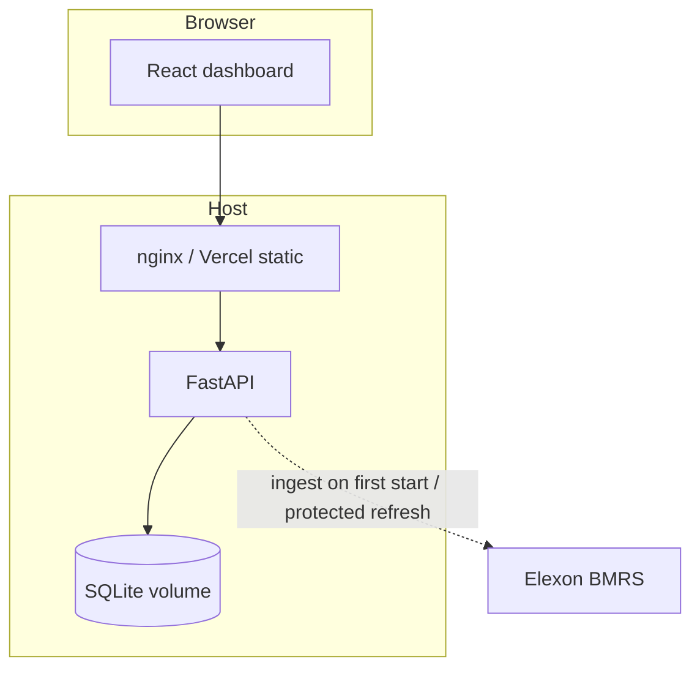
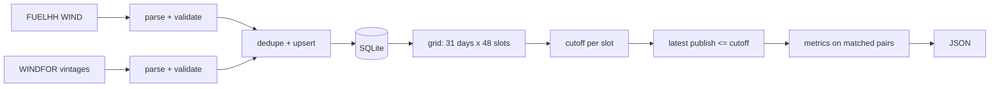

# Architecture

## Components
- **Frontend** (`frontend/`): React 18 + TypeScript + Vite, Recharts. Presentation only; every metric is computed by the backend. Served by nginx in Docker (which also proxies `/api`), or by Vercel.
- **Backend** (`backend/app`): FastAPI. `elexon.py` (client, retries, validation) → `ingest.py` (windowed fetch, dedupe, upsert, run log) → `db.py` (SQLite) → `analysis.py` (cutoff selection, metrics, vintage analysis) → `main.py` (routes, validation, CORS, error handling).
- **Storage**: SQLite (WAL). Tables `actuals`, `forecasts` (PK `start_utc, publish_utc` — every vintage preserved), `ingest_runs` (provenance, stats, failures).

## Data flow

## API design
Versioned `/api/v1`, uniform `{meta, data}` envelope, `{error:{code,message}}` on failure, 422 for invalid params (dates outside January, `start>end`, bad `cutoff`), 503 while no data is loaded. OpenAPI at `/docs`.

## Forecast vintage selection
See `analysis._frame_cached`: a full 30-minute grid is built for January (so missing actuals are visible, not absent), a cutoff is computed per slot, forecasts are joined on target time, filtered to `publish <= cutoff`, and the row with the maximum `publish` kept. The "latest" series is selected independently. Nothing after the cutoff can enter the decision series.

## Metrics
Computed in `analysis.metrics` from matched (non-NaN) pairs only; n, eligible and coverage returned with each result.

## Caching
Ingestion is never triggered by a request. Analysis frames are `lru_cache`d keyed on (last successful ingest id, settings, cutoff); a refresh invalidates them naturally.

## Error handling
Elexon calls: timeout, retry with exponential backoff on 429/5xx/transport errors. Malformed records are counted and sampled in `ingest_runs.stats` (not silently dropped). A failed ingest is logged in `ingest_runs` and the previous good data stays served. Unhandled exceptions return a generic 500; details only in logs.

## Security
No secrets in code. `POST /refresh` is disabled unless `REFRESH_TOKEN` is set, uses constant-time comparison, and a lock plus 409 prevents concurrent runs. CORS allowlist via env. Container runs as non-root. Parameters are validated; SQL is parameterised.

## Deployment
Local/Docker: nginx(8080) → FastAPI(8000), volume for SQLite. Hosted (intended): static frontend on Vercel with `VITE_API_BASE_URL`, backend container on a host with a persistent disk (`render.yaml`); the backend self-ingests when its database is empty, so even ephemeral disks recover (cold start ≈ 1 minute).

## Trade-offs
SQLite + pandas: tiny data (≈20k forecast rows), simple ops, single-writer. A per-request recompute is cheap and avoids stale derived tables. Charts use hourly rows only so they align with the metric basis; half-hourly detail lives in the table.
